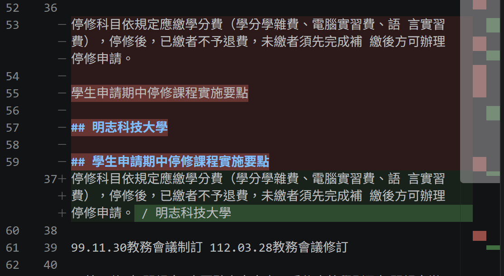
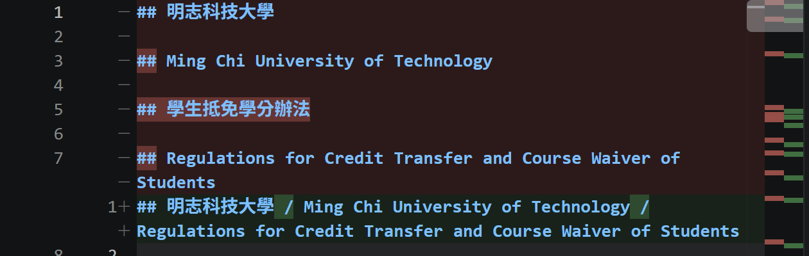
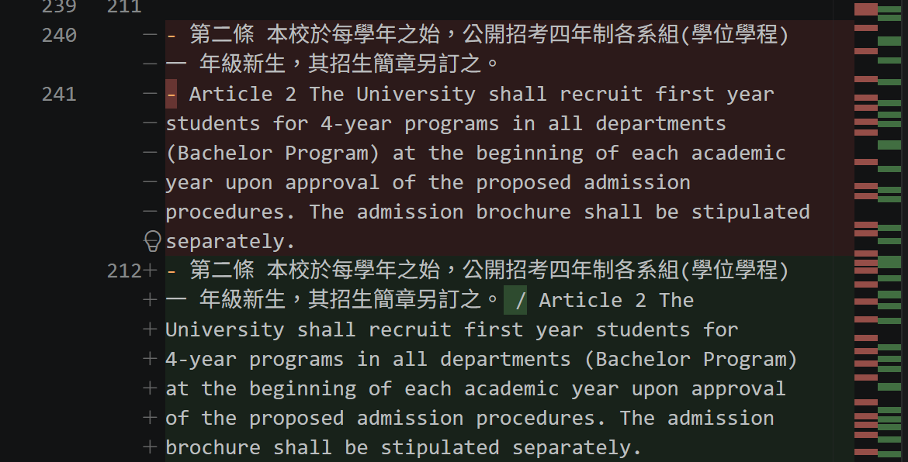
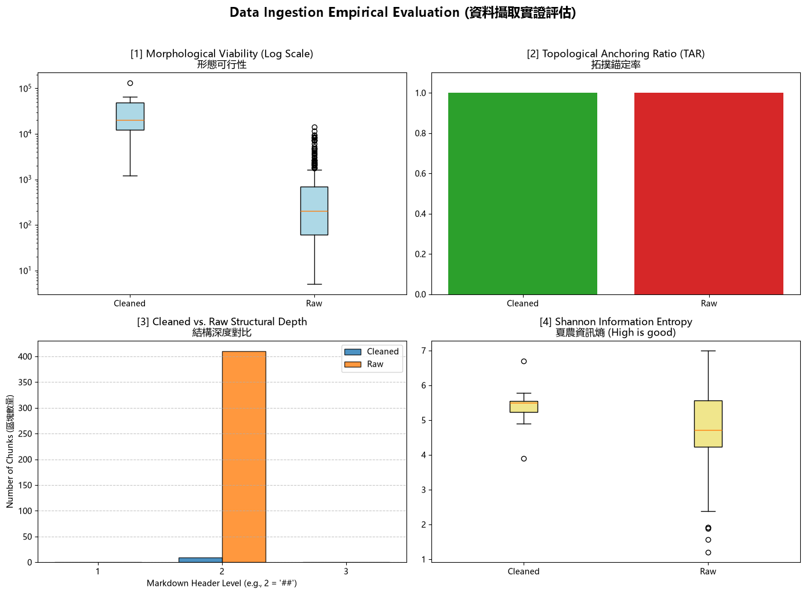

# 資料前處理報告 (Data Preparation Report)
- **學號 / 姓名**：U12627011 李庭安
- **專案名稱**：nlp-mcut-qa-system
- **完成的任務**：- [x] 1-A 頁首頁尾清除　- [x] 1-B 雙語標題合併　- [x] 1-C 雙語條文合併

---

## 1. 資料集概覽 (Dataset Overview)

| 類別 (Cluster) | PDF 數量 | 清洗前 chunk 數 | 清洗後 chunk 數 |
|---|---|---|---|
| （例：Academic_Affairs） |9|20|9|
| **合計** |9|410|9|

**問題 (2–3 句)：** 清洗後 chunk 數量變少了多少？是哪個任務造成的？有沒有哪個任務**不影響** chunk 數量？為什麼？

**回答：**
chunk 數量變少了 410-9=401。 
1-B 把這些 ## 標記移除後，後續就找不到原本的切割位置，導致每份 PDF 剩下一個 Chunk。 
1-C 它處理的是以 - 開頭的英文條文，並沒有修改 Markdown 標題的 ## 標記。


___

## 2. 清洗步驟 (Cleaning Steps)

### 2.1 任務 1-A：頁首頁尾溢出清除

- 檔名：raw_A231060004_學生申請期中停修課程實施要點.md　搜尋的文字：無，手動尋找。
- 截圖 ：
- 改變了什麼：移除正文中重複出現的法規名稱，避免多餘頁首資訊干擾文件內容。
- 這對之後的問答檢索有什麼幫助：減少重複文字，讓檢索系統更集中於實際法規內容。
- 這個任務有沒有**改錯**的地方 (把不該改的也改了)？若有，寫出檔名與搜尋的文字；若沒有，寫「沒有發現」：沒有發現。

### 2.2 任務 1-B：雙語標題合併

- 檔名：raw_A232060013_學生抵免學分辦法.md　搜尋的文字：無，一開始就看到了。
- 截圖：
- 改變了什麼：將原本分開的中文及英文標題合併為同一行，並使用 / 分隔，使雙語標題保留在同一個結構區塊中。
- 這對之後的問答檢索有什麼幫助：讓中英文標題維持語意關聯，避免文件切塊時產生缺乏上下文的標題區塊，提升雙語查詢的檢索完整性。
- 這個任務有沒有**改錯**的地方 (把不該改的也改了)？若有，寫出檔名與搜尋的文字；若沒有，寫「沒有發現」：沒有發現

### 2.3 任務 1-C：雙語條文合併

- 檔名：raw_A232020018_大學部學則.md　搜尋的文字：無，手動尋找。
- 截圖：
- 改變了什麼：將中文第二條與對應的英文 Article 2 合併為同一段文字。
- 這對之後的問答檢索有什麼幫助：中文與英文條文位於同一段落，能讓雙語查詢取得相同的條文內容。
- 這個任務有沒有**改錯**的地方 (把不該改的也改了)？若有，寫出檔名與搜尋的文字；若沒有，寫「沒有發現」：沒有發現。

## 3. 評估指標與 AI 解讀查證 (Metrics & Verifying the AI's Interpretation)

### 3.1 指標數據表

| 指標 | Raw | Cleaned (你的) | Cleaned (參考值) |
|---|---|---|---|
| [1] 中位數長度 Median Length |205.0|20148.0|270.5|
| [2] 拓撲錨定率 TAR |1.0|1.0|1.0|
| [3] 深度變異量 SDV (選填) |0.0|0.0| |
| [4] 中位數資訊熵 Entropy (選填) |4.719958679606001|5.503287312969262|4.722966879142464|




Cleaned 結果與參考值不一致，主要原因是 Task 1-B 的標題合併規則過於寬鬆，破壞 Markdown 標題結構，導致 Chunk 數量大幅減少、中位數長度異常增加，進而影響資訊熵。

### 3.2 AI 的解讀

- 使用的 AI 工具：GPT

```text
Data Ingestion Empirical Evaluation 結果分析

本次資料擷取實證評估顯示，資料清洗後的拓撲錨定率維持在 1.0，表示清洗前後的錨點保留情形沒有改變；資訊熵則由 4.720 提升至 5.503。然而，形態可行性指標出現明顯異常，中位數長度由 205 增加至 20,148，遠高於參考值 270.5。

進一步觀察結構深度分布，Raw 資料約有 410 個 Chunk，而 Cleaned 資料僅剩約 9 個，顯示清洗過程可能破壞原有的 Markdown 標題結構，影響後續文件切塊。

綜合而言，目前清洗流程雖然改善部分文字內容的組織方式，但 Task 1-B 的標題合併規則過於寬鬆，造成一般內文與 Markdown 標題被錯誤合併，進而影響 Chunking 品質。因此，後續應優先修正標題合併規則，再重新執行資料切塊與指標評估，以確保資料能有效支援後續問答檢索。
```

### 3.3 你的查證 (至少兩點)

**查證 1**
- AI 的說法：Task 1-B 的標題合併規則過於寬鬆，會造成一般內文與 Markdown 標題被錯誤合併。
- 我查了什麼 (哪個檔案、哪個 chunk、哪段程式)：查看 01_Data_Ingestion.ipynb 的 Cell 23，其中 ([^\n]+) 可以匹配任何非換行文字，並不限於以 ## 開頭的標題。
比對 raw_A232020018_大學部學則.md 與 cleaned_A232020018_大學部學則.md，發現原始文件中的 MOE 備查文字，在清洗後被合併到「第一篇 總則」及其英文標題前面。
- 結論：正確
，因為正規表示式沒有嚴格限制前一行必須是 Markdown 標題，導致一般內文也可能被合併，確實存在誤合併問題。

**查證 2**
- AI 的說法：Task 1-B 破壞原有 Markdown 標題結構，造成 Chunk 數量從 Raw 約 410 個下降至 Cleaned 約 9 個。
- 我查了什麼：查看 01_Data_Ingestion.ipynb 的 Cell 28，代表程式依照換行後的 ## 標記切分文件。
同一個 Cell 28 中，Task 1-B 會將匹配到的第二個 ## 移除，因此部分原本可以作為切塊邊界的標題會消失。
- 結論：正確
，因為 Task 1-B 移除了部分標題標記，而後續 Chunking 又依賴 ## 進行切分，造成大量原有切塊邊界消失。實際數量變化也與圖表結果一致。

### 3.4 實際證據：你被指定的 chunk
- **SEED**：1106

**(a) 很長的 chunk**
- 資料檔 (JSON)：cleaned_A232020018_大學部學則_processed.json　位置：第 0 個 (從 0 開始數)　長度：64,470 字元 字元　驗證碼：c62b5fbd
- 閱讀用檔案 (`.md`)：cleaned_A232020018_大學部學則.md　從第 1 行開始
- 前 3 行內容：
  ```text
  ## 明志科技大學 / Ming Chi University of Technology / Academic Regulations for Undergraduate Studies

  制定部門：教務處

  Formulated by: Office of Academic Affairs, Ming Chi University of Technology
  ```
- 這是什麼樣的文字？為什麼會這麼長？
這是一份明志科技大學的《大學部學則》，內容包含中英文規章名稱、制定部門、修訂紀錄、法規條文及英文翻譯等。Chunk 長度異常，可能是因為前面的 Markdown 標題合併處理破壞了原有的 ## 標題分隔符號，使原本應該分開的章節無法正常切分，最後將大量不同章節合併成同一個 Chunk。

- 之後做問答檢索時，這麼長的 chunk 可能造成什麼問題？
過長的 Chunk 會包含多個不同主題，降低檢索內容的精確度。當使用者詢問特定條文時，系統可能一次取回大量無關內容，增加上下文負擔，也可能讓生成模型難以找到真正相關的資訊，影響回答品質。

**(b) 資訊熵很低的 chunk**
- 資料檔 (JSON)：cleaned_A271010023_圖書館管理作業規範_processed.json　位置：第 0 個 (從 0 開始數)　資訊熵：5.22　驗證碼：498cb88d
- 閱讀用檔案 (`.md`)：leaned_A271010023_圖書館管理作業規範.md　從第 1 行開始
- 內容：
  ```text
  ## 明 志 科 技 大 學

  Ming Chi University of Technology / Ming

  Work Specification for Library Management System

  制定部門：圖書資訊處
  ```
- 為什麼它的資訊熵這麼低？它對問答檢索有用嗎？
  從預覽可看出，文件開頭主要包含學校名稱、英文名稱、規章名稱及制定部門等行政資訊。若整份文件也包含大量重複的修訂紀錄、固定格式及制式文字，文字分布可能較集中，因此資訊熵相對較低。

  這類內容仍具有一定的檢索價值，例如查詢規章名稱、制定部門或修訂資訊時可以使用；但如果整個 Chunk 都以重複的行政資訊為主，對於回答具體的圖書館管理規定、作業流程等問題，幫助就比較有限。

## 4. 一個尚未解決的問題 (One Remaining Problem)

- **檔名** (`cleaned_*.md`)：cleaned_A273060005_學生電子郵件帳號管理要點.md　**從第 1 行開始** (VS Code 左側的行號)　**標題**：## 明 志 科 技 大 學 / Ming Chi University of Technology
- **我是怎麼找到的** (例如：搜尋了什麼、看了哪個檔案)：查看 cleaned_A273060005_學生電子郵件帳號管理要點.md，在「第三條 系統管理與處置措施」，發現第三條的中文標題及內容被接在第二條英文條文的編號清單後面。接著比對對應的 Raw 檔案，確認原始文件中第三條原本是獨立的條文內容。
- **問題 chunk (貼上部分內容)**：

```text
5. A dropout shall be deemed to have lost the University's
   student status; therefore, the right to use the account
   shall be cancelled.
6. 第三條 系統管理與處置措施 為配合本校公務需求、
   資訊安全與系統管理維護，本組可進行下列措施：
7. 一、 交付電子郵件地址清單予需求單位。
8. 二、 使用者必須配合本組通知，定期更換密碼。
9. 三、 針對系統資料進行緊急處置。
10. 四、 設定使用者信箱資安相關參數。
```

- **問題是什麼**：原本第二條的英文條文只包含五項適用對象，但清洗後卻將第三條的中文標題及後續條文接在第二條的英文編號清單後面，甚至將第三條的內容錯誤編為第 6 至第 15 項，造成不同條文的內容混在一起，破壞原有的條文結構。
- **可能的原因** (PDF 本身？Docling 轉換？清洗的正則表示式？切塊規則？)：清洗過程中的正規表示式可能錯誤合併了標題與內文，導致原本用來區隔條文的 Markdown ## 標題標記消失，使後續 Chunking 無法正確區分不同條文。
- **具體的修正方法** (例如：一條規則、一個正則表示式的構想、長度上限)：修改標題合併規則，限制只能合併相鄰且確實屬於中英文對照的標題，不能將一般條文內容與標題合併。
- **對問答檢索的影響**：不同條文被合併後，使用者查詢第二條時，檢索系統可能同時取得第三條的內容，造成檢索結果不精確。生成模型也可能混淆條文的適用範圍，進而產生錯誤回答。

## 5. AI 協作 (AI Collaboration)

- 本次作業的 AI 協作紀錄請見 [`AI_USAGE.md`](AI_USAGE.md) 的「Week 04 / 08」與「Week 09」段落。
- 這次使用 AI 最大的收穫或教訓是 這次使用 AI 最大的收穫是：

  AI 可以協助快速分析資料與找出潛在問題，但不能直接把 AI 的解讀當成正確答案，仍然需要回到原始檔案與程式碼驗證。

  最關鍵的是提示詞必須明確要求 AI 使用真實 PDF 轉換後的 Raw 與 Cleaned Markdown 進行比較，而不是使用 Notebook 內的測試範例。此外，我也發現 AI 最初對清洗結果的部分解讀不夠準確，例如將資訊熵提高解讀為資訊品質改善，但實際上資訊熵提高不代表檢索品質一定變好。透過檢查正規表示式及比對清洗前後的文件，我才確認 Task 1-B 的標題合併規則過於寬鬆，造成不同條文被錯誤合併。

  我學到使用 AI 不只是取得答案，更重要的是要求它提出可驗證的依據，並透過實際資料確認分析是否正確。
